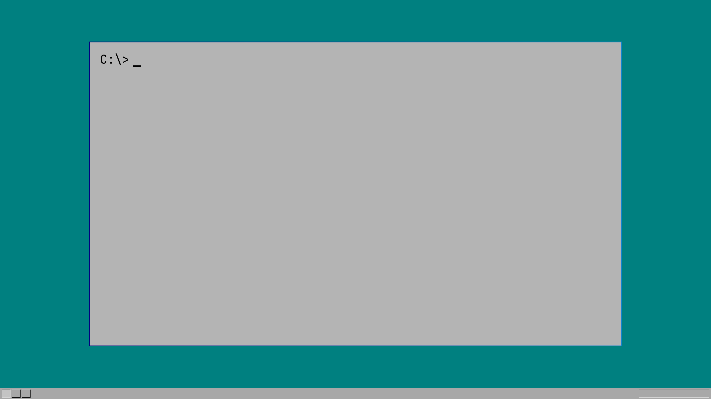
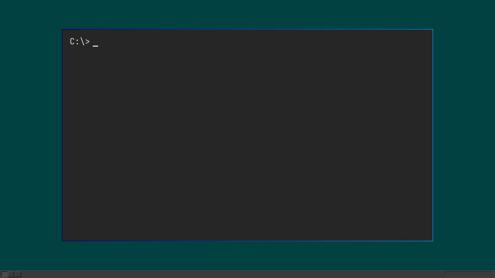

# Memphis — a Win98-inspired theme for Omarchy


Memphis gives [Omarchy](https://omarchy.org) the look of a 1998 desktop: a teal desktop, a gray bar at the bottom with a raised edge, navy window borders, square corners, no animations, Chicago95 for GTK apps and a light gray "Notepad" palette for the terminal.

It comes in three Variants, each one a separate Omarchy theme:

| Variant | Terminal | Bar and menus | Desktop | GTK apps |
|---|---|---|---|---|
| `memphis` | Light gray `#E8E8E8`, black text | `#C0C0C0` | Teal | Chicago95 |
| `memphis-gray` | Medium gray `#B4B4B4`, black text | `#A8A8A8` | Teal | Chicago95 |
| `memphis-dark` | Charcoal `#262626`, light gray text | `#3A3A3A` | Dark teal | Omarchy's Adwaita-dark |

| `memphis` | `memphis-gray` | `memphis-dark` |
|---|---|---|
|  |  |  |

It keeps the parts of Omarchy that you use every day. Windows still tile, super+space still opens the menu, and the terminal and bar keep your monospace font.

## Requirements

- Omarchy 4.5 or later (Hyprland with Lua config, the Quickshell bar).
- `yay`, for the Chicago95 packages from the AUR.

## Install

```bash
git clone https://github.com/matiaslapolla/omarchy-memphis-theme ~/.local/share/omarchy-memphis-theme
cd ~/.local/share/omarchy-memphis-theme
./install.sh            # add --dry-run to see each step first
omarchy theme set memphis   # or memphis-gray, memphis-dark
```

`install.sh` does not apply the theme. The look changes only when you run `omarchy theme set` with a Variant. The only live change during the install is the bar reload in step 6. The bar looks the same as before, because the bevel edge draws only under Memphis.

What `install.sh` does:

1. Installs `chicago95-gtk-theme-git`, `chicago95-icon-theme-git` and `xcursor-chicago95-git` with `yay`. Skip this step with `--no-packages`.
2. Copies the W95FA font to `~/.local/share/fonts/memphis/`.
3. Links this repo to `~/.config/omarchy/themes/memphis`, and `variants/memphis-gray` and `variants/memphis-dark` to `themes/memphis-gray` and `themes/memphis-dark`. A link keeps `hyprland.lua`, which Omarchy drops from a theme that was cloned with `omarchy theme install`.
   If one of these dirs already exists and is not our link, the installer moves it to `~/.config/omarchy/<variant>-theme.old.<timestamp>`.
4. Copies three hooks to `~/.config/omarchy/hooks/{theme-set,post-boot,post-update}.d/memphis`.
5. Builds the bevel bar `memphis.bar` in `~/.config/omarchy/plugins/`. It is a copy of the stock bar with a 1 px light and dark edge.
6. If your bar is the stock `omarchy.bar`, runs `omarchy bar use memphis.bar`. The shell reloads the bar once.
   If you use another custom bar, the installer keeps it. It prints the command to switch by hand.

### Colors only

```bash
omarchy theme install https://github.com/matiaslapolla/omarchy-memphis-theme
```

This gives the light Variant only: the palette, the shell colors, the backgrounds and the window border colors. It does not give Chicago95, the font, the bevel bar, the bottom bar, square borders or the animation change.

## What changes when Memphis is active

| Part | With Memphis |
|---|---|
| Desktop | Teal `#008080` (dark teal `#004040` in `memphis-dark`) with the Omarchy wordmark (default), or solid |
| Windows | 3 px navy-to-blue border on the active window, gray on others, no rounding, shadow, blur or animations. Floating titlebars are 40 px high with 32 px buttons |
| Bar | Bottom, in the Variant gray, a light edge on top, your widgets in the same order. The bar engine stays `memphis.bar` under every theme. |
| Menu, popups, notifications | Gray with a raised edge and a selected row that keeps its subtitle readable: lighter than the menu in the light Variants, darker in `memphis-dark` |
| GTK apps | Chicago95 icons and cursor, W95FA 11 as the interface font. The Chicago95 GTK theme in `memphis` and `memphis-gray` only, because it has no dark version |
| Terminal | The Variant background, a navy (or blue) selection and Windows console colors with a 4.2:1 contrast or more |

## Switching back

Switch to any theme that is not a Memphis Variant. A switch between two Variants keeps your saved values. The `theme-set` hook restores the cursor, the GTK font and the bar position from `~/.local/state/memphis/saved.env`. That file holds your values from before the first switch to Memphis.

The bar stays on `memphis.bar`. Under another theme it looks the same as the stock bar, because the bevel edge draws only under Memphis. The hook does not switch the bar engine, because a switch during `omarchy theme set` can break the new bar. To go back to the stock bar, run `omarchy bar reset`.

## Update

```bash
cd ~/.local/share/omarchy-memphis-theme && git pull && ./install.sh --no-packages
```

The `post-update` hook builds the bevel bar again after each `omarchy update`. If the stock bar changed too much, the hook removes `memphis.bar`, goes back to the stock bar and sends a notification.

## Uninstall

Switch to another theme first, then:

```bash
./uninstall.sh
```

It removes the hooks, the three theme links, the bevel bar and the font. If `memphis.bar` is the active bar, it runs `omarchy bar reset` first, and the shell reloads the bar. It prints the `yay -R` command for the packages and does not run it.

## Known conflicts

Some shell plugins set the cursor themselves, for example Cursor Accent. Such a plugin overrides the Chicago95 cursor. Disable it while a Memphis Variant is active.

## Development

```bash
tests/run.sh                     # shellcheck + all tests
extras/assets/gen-images.sh .    # rebuild the previews and backgrounds of all three Variants
```

The tests run the installer and the hooks under a temporary `HOME` with stub commands. They never touch the running desktop. The spec is in `docs/specs/memphis-theme.md`.

## Credits

- [Chicago95](https://github.com/grassmunk/Chicago95) for the GTK theme, icons and cursors (GPL-3.0+/MIT, installed from the AUR, not bundled).
- [W95FA](https://fontsarena.com/w95fa-by-alina-sava/) by Alina Sava (SIL OFL 1.1, bundled in `fonts/` with its license).
- The wallpaper wordmark is Omarchy's own `logo.txt` from [Omarchy](https://github.com/omacom/omarchy) (MIT), copied to `extras/assets/omarchy-wordmark.txt` and drawn as pixel blocks.
- Palette values cross-checked with [98.css](https://github.com/jdan/98.css) and Chicago95.

## Disclaimer

Memphis is not affiliated with or endorsed by Microsoft. Windows is a trademark of Microsoft Corporation. This repo contains no Microsoft images, fonts, icons or cursors. Every image here is generated by `extras/assets/gen-images.sh`.

## License

MIT for the code and images in this repo. `fonts/W95FA.otf` keeps the SIL Open Font License 1.1 in `fonts/OFL.txt`.
