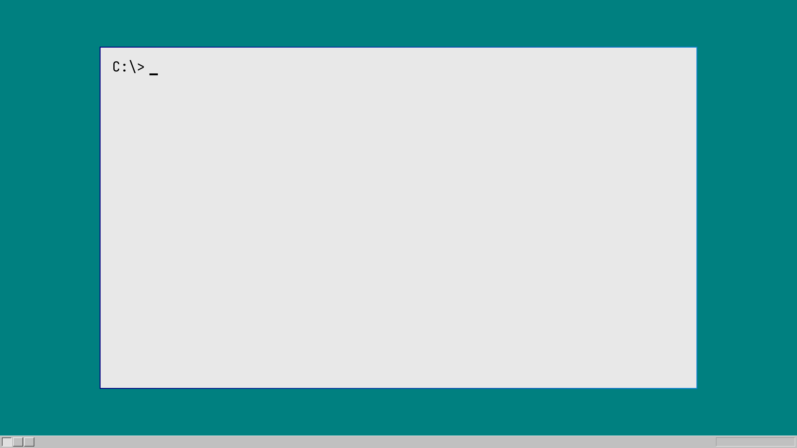

# Memphis — a Win98-inspired theme for Omarchy



Memphis gives [Omarchy](https://omarchy.org) the look of a 1998 desktop: a teal desktop, a gray bar at the bottom with a raised edge, navy window borders, square corners, no animations, Chicago95 for GTK apps and an MS-DOS Prompt palette for the terminal.

It keeps the parts of Omarchy that you use every day. Windows still tile, super+space still opens the menu, and the terminal and bar keep your monospace font.

## Requirements

- Omarchy 4.5 or later (Hyprland with Lua config, the Quickshell bar).
- `yay`, for the Chicago95 packages from the AUR.

## Install

```bash
git clone https://github.com/matiaslapolla/omarchy-memphis-theme ~/.local/share/omarchy-memphis-theme
cd ~/.local/share/omarchy-memphis-theme
./install.sh            # add --dry-run to see each step first
omarchy theme set memphis
```

`install.sh` changes nothing on screen. The look changes only when you run `omarchy theme set memphis`.

What `install.sh` does:

1. Installs `chicago95-gtk-theme-git`, `chicago95-icon-theme-git` and `xcursor-chicago95-git` with `yay`. Skip this step with `--no-packages`.
2. Copies the W95FA font to `~/.local/share/fonts/memphis/`.
3. Links this repo to `~/.config/omarchy/themes/memphis`. A link keeps `hyprland.lua`, which Omarchy drops from a theme that was cloned with `omarchy theme install`.
   If `themes/memphis` already exists and is not this link, the installer moves it to `~/.config/omarchy/memphis-theme.old.<timestamp>`.
4. Copies three hooks to `~/.config/omarchy/hooks/{theme-set,post-boot,post-update}.d/memphis`.
5. Builds the bevel bar `memphis.bar` in `~/.config/omarchy/plugins/`. It is a copy of the stock bar with a 1 px light and dark edge.

### Colors only

```bash
omarchy theme install https://github.com/matiaslapolla/omarchy-memphis-theme
```

This gives the palette, the shell colors, the backgrounds and the window border colors. It does not give Chicago95, the font, the bevel bar, the bottom bar, square borders or the animation change.

## What changes when Memphis is active

| Part | With Memphis |
|---|---|
| Desktop | Teal `#008080`: solid, dithered or woven |
| Windows | 3 px navy-to-blue border on the active window, gray on others, no rounding, shadow, blur or animations |
| Bar | Bottom, `#C0C0C0`, white edge on top, your widgets in the same order |
| Menu, popups, notifications | Gray with a raised edge, navy selection, yellow tooltips |
| GTK apps | Chicago95 theme, icons and cursor, W95FA 11 as the interface font |
| Terminal | Black with `#C0C0C0` text and the Windows console colors |

## Switching back

Switch to any other theme. The `theme-set` hook restores the cursor, the GTK font, the bar plugin and the bar position from `~/.local/state/memphis/saved.env`. That file holds your values from before the first switch to Memphis.

## Update

```bash
cd ~/.local/share/omarchy-memphis-theme && git pull && ./install.sh --no-packages
```

The `post-update` hook builds the bevel bar again after each `omarchy update`. If the stock bar changed too much, the hook removes `memphis.bar`, goes back to the stock bar and sends a notification.

## Uninstall

Switch to another theme first, then:

```bash
./uninstall.sh
```

It removes the hooks, the theme link, the bevel bar and the font. It prints the `yay -R` command for the packages and does not run it.

## Development

```bash
tests/run.sh                     # shellcheck + all tests
extras/assets/gen-images.sh .    # rebuild the previews and backgrounds
```

The tests run the installer and the hooks under a temporary `HOME` with stub commands. They never touch the running desktop. The spec is in `docs/specs/memphis-theme.md`.

## Credits

- [Chicago95](https://github.com/grassmunk/Chicago95) for the GTK theme, icons and cursors (GPL-3.0+/MIT, installed from the AUR, not bundled).
- [W95FA](https://fontsarena.com/w95fa-by-alina-sava/) by Alina Sava (SIL OFL 1.1, bundled in `fonts/` with its license).
- Palette values cross-checked with [98.css](https://github.com/jdan/98.css) and Chicago95.

## Disclaimer

Memphis is not affiliated with or endorsed by Microsoft. Windows is a trademark of Microsoft Corporation. This repo contains no Microsoft images, fonts, icons or cursors. Every image here is generated by `extras/assets/gen-images.sh`.

## License

MIT for the code and images in this repo. `fonts/W95FA.otf` keeps the SIL Open Font License 1.1 in `fonts/OFL.txt`.
